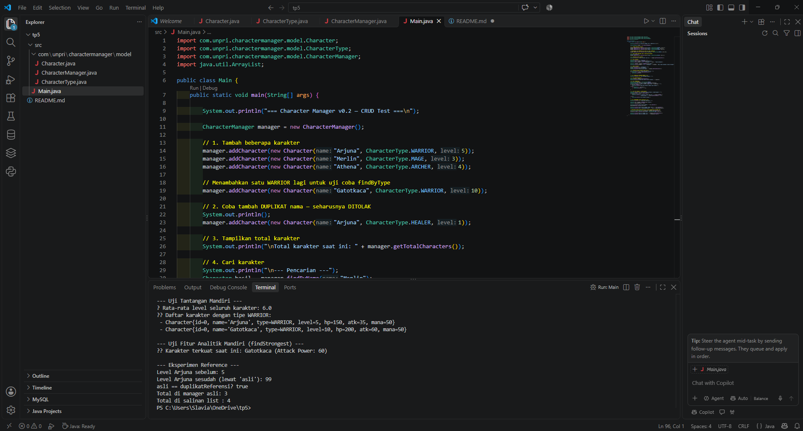

# Character Manager - TP5 (Java Visual SIH-6406)

Character Manager adalah aplikasi berbasis konsol Java yang dirancang untuk mengelola data karakter game (seperti Warrior, Mage, Archer, dan Healer) dengan menerapkan konsep Object-Oriented Programming (OOP) seperti enkapsulasi, enum, konstruktor ganda, dan validasi data.

# Bagian C — Penjelasan Rasional Fitur Mandiri (findStrongest)

​Pada kelas CharacterManager, kami menambahkan fitur analitik mandiri yaitu method findStrongest(). Method ini dirancang untuk memindai seluruh karakter yang tersimpan di dalam ArrayList<Character> dan mengembalikan objek Character yang memiliki nilai attackPower terbesar.
​Rasionalitas & Penerapan Enkapsulasi:
​Kegunaan Analitik: Fitur ini mempermudah sistem dalam menentukan pemain/karakter terkuat untuk keperluan statistik, arena battle, atau penentuan leaderboard.
​Penanganan Kasus Khusus (Corner Cases): Jika characterList berada dalam keadaan kosong, method akan secara aman mengembalikan nilai null tanpa menyebabkan crash/IndexOutOfBoundsException.
​Penerapan Enkapsulasi & Reference: Method ini mengembalikan reference ke objek Character yang ada atau null. Objek ArrayList<Character> utama (characterList) tetap tersembunyi dengan modifier private di dalam CharacterManager, sehingga struktur data internal tidak dapat diubah dari luar tanpa melalui mekanisme method yang sah.

## Screenshot Output Terminal



## Struktur Folder Project

```text
AP3_Tugas/
├── Screenshot 2026-10-17 101305.png
├── README.md
└── src/
    ├── Main.java
    └── com/
        └── unpri/
            └── charactermanager/
                └── model/
                    ├── Character.java
                    └── CharacterType.java

Nama    : Slavia Praha Husada
Nim     : (253303621221)
Kelas   : Semester 3 Pagi A
Link Google Docs :  https://docs.google.com/document/d/1KXVY3-9Y2yK-rjjoAye8Mm0wjhyL0hGETEIEPkdeZYQ/edit?usp=sharing
